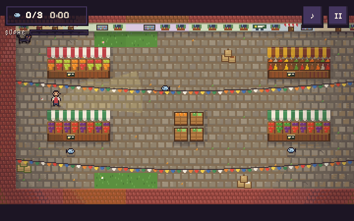

**English** · [Türkçe](README.tr.md)

# Kaçak Kedi (Sneaky Cat) 🐈‍⬛

A pixel-art stealth game about a sneaky black cat stealing fish from the market. Top-down, 6 levels; play in the browser with a keyboard or by touch on your phone.

🐟 **Play in your browser:** https://muhammedozkul.github.io/kacak-kedi/

No installation required; works in Chrome, Edge, Safari or Firefox on computers and phones.

<p align="center"></p>

## Opening it on your computer

Download the repository and double-click `index.html`. No installation, server or internet needed (only the pixel font is loaded from the internet; a fallback font is used otherwise).

## How to play

- **Goal:** Grab all the fish, then run to the glowing escape hole.
- **The yellow area** is what a vendor can see. Step into it and the suspicion bar fills up; if it fills, you're caught.
- **Sneak:** Shift (on phones, push the joystick gently or hold the SESSİZ / sneak button). You're slower, but dogs can't hear you and puddles don't splash.
- **Hide:** In sack piles and under tea tables you're invisible while standing still or sneaking.
- **Dogs** see poorly but hear very well; don't wake the sleeping ones.
- **Stars:** ★ finish · ★ finish under the target time · ★ finish without being noticed. Progress is saved in the browser.

| Key | Action |
| --- | --- |
| Arrows / WASD | Move |
| Shift | Sneak |
| Esc / P | Pause |
| R | Restart level |
| M | Sound on/off |
| Enter | Start level |

## Levels

1. Fish Market · 2. Butcher Street · 3. Tea Garden · 4. Rainy Street · 5. Dog Yard · 6. Harbor

## Technical

Plain HTML, CSS and JavaScript; no build step or libraries. All graphics (the cat, vendors, dogs, stalls, buildings) and sounds are generated in code; no external image or audio files are used.

```
index.html           Screens and HUD
css/stil.css         Pixel interface
js/sprite.js         Character sprites (letter grids)
js/harita-cizim.js   Tile and decoration drawing
js/bolumler.js       Level maps and guard routes
js/oyun.js           Engine: movement, vision cones, suspicion, pathfinding, rendering
js/giris.js          Keyboard and touch joystick
js/ses.js            8-bit effects with Web Audio
js/arayuz.js         Screen flow, progress saving
```

Font: [Pixelify Sans](https://fonts.google.com/specimen/Pixelify+Sans) (SIL Open Font License).

---

Developed by: Muhammed Yaşar ÖZKUL
